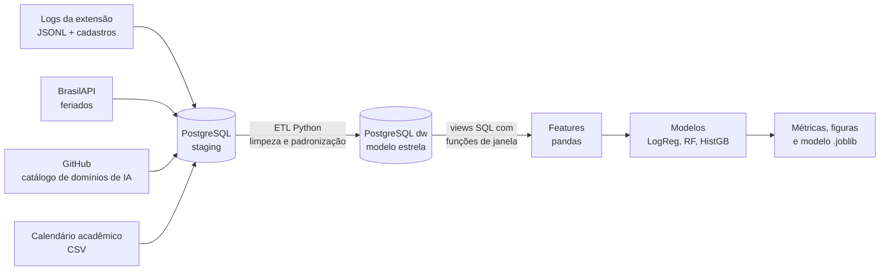
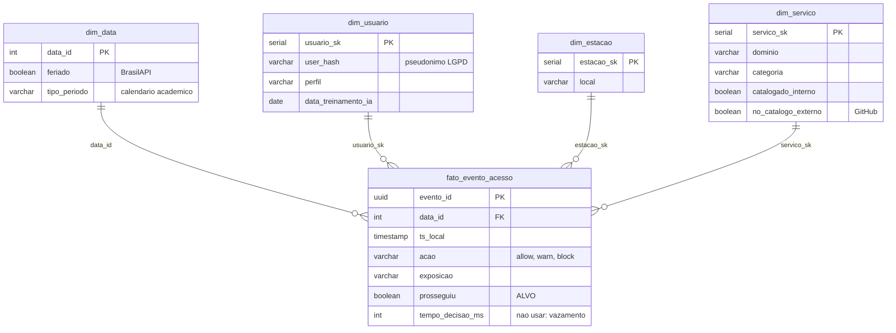

# Sentinela Shadow AI: Pipeline End-to-End de Engenharia de Dados e ML

**Projeto Integrador (P15) | Banco de Dados para Engenharia de Dados (BDED 2026.1)**
Especialização em Projetos em Inteligência Artificial, UNIFAP Digital
Docente: Prof. Dr. Adolfo Francesco de Oliveira Colares
Autor (equipe individual): **Prof.º Esp. Hernane Bini** ([@Hbini](https://github.com/Hbini))

---

## 1. Descrição

Instituições de ensino convivem com a **Shadow AI**: o uso de serviços de IA generativa (ChatGPT, parafraseadores,
resolvedores de exercícios etc.) fora da governança institucional. O **Sentinela**, produto do meu TCC, é uma extensão
de navegador que **permite** (`allow`), **alerta** (`warn`) ou **bloqueia** (`block`) esses acessos e envia cada evento a
um orquestrador n8n.

Quando recebe um alerta, o usuário pode respeitá-lo ou **ignorá-lo e prosseguir**. Este projeto constrói um pipeline
completo que responde:

> **Dado um alerta do Sentinela, qual a probabilidade de o usuário ignorá-lo?** (classificação binária)

Com essa probabilidade a gestão consegue **priorizar ações** (letramento em IA, ajuste de política, comunicação) onde
o alerta é menos efetivo.



## 2. Fontes de dados (4)

| # | Fonte | Formato | Como é obtida |
|---|-------|---------|---------------|
| 1 | Eventos da extensão Sentinela, cadastro pseudonimizado de usuários e estações, política interna | JSONL / CSV | `src/extract/gerar_eventos_sentinela.py` (simulação com semente fixa) |
| 2 | Feriados nacionais 2026 | API REST JSON | [BrasilAPI](https://brasilapi.com.br/api/feriados/v1/2026) |
| 3 | Catálogo público de domínios de IA | TXT (formato hosts) | API do GitHub, repositório [`abixb/llm-hosts-blocklist`](https://github.com/abixb/llm-hosts-blocklist) |
| 4 | Calendário acadêmico 2026.1 (provas, entregas, recessos) | CSV | `data/raw/calendario_academico_2026.csv` |

> **Nota de transparência (fonte 1).** O Sentinela está em fase piloto, sem volume real de eventos, e o uso de
> registros reais de estudantes exigiria consentimento e base legal (LGPD). Por isso os eventos são **simulados**
> com o mesmo esquema da extensão v0.2 (event_id, ts em UTC, station_id, user_hash, domain, action, exposure,
> decision...). A simulação usa as fontes reais 2 e 4 para modular volume e comportamento e injeta, de propósito,
> problemas de qualidade típicos de produção (duplicatas da fila de reenvio, domínios com `www.`/maiúsculas, nulos,
> categorias inconsistentes e chaves órfãs) para serem tratados no ETL.
>
> **Resiliência:** se a BrasilAPI ou o GitHub estiverem fora do ar, o pipeline usa os snapshots versionados em
> `data/cache/` e registra a origem efetiva em `reports/qualidade_dados.json`.

## 3. Estrutura do repositório

```
sentinela-shadow-ai-pipeline/
├── run_pipeline.py                  # executa tudo: coleta -> ETL -> features -> modelo
├── requirements.txt
├── .env.example                     # modelo de configuração do PostgreSQL
├── sql/
│   ├── 01_schema.sql                # esquemas staging e dw (estrela), constraints e índices
│   ├── 02_views.sql                 # base de ML com funções de janela + views analíticas
│   └── 03_consultas_analiticas.sql  # consultas de governança (calendário, ranking, fadiga...)
├── src/
│   ├── config.py                    # caminhos, conexão e parâmetros
│   ├── extract/                     # fontes: feriados (API), catálogo (GitHub), eventos (simulação)
│   ├── etl/pipeline_etl.py          # E -> staging, T em pandas, L no modelo estrela
│   ├── features/build_features.py   # engenharia de features
│   └── models/train.py              # CV temporal, treino, avaliação, vazamento, importância
├── notebooks/
│   ├── 01_analise_exploratoria.ipynb
│   └── 02_pipeline_completo.ipynb   # notebook final (entrega no Moodle)
├── data/
│   ├── raw/                         # dados brutos (fontes 1 e 4)
│   ├── cache/                       # snapshots de fallback das fontes 2 e 3
│   ├── external/                    # (gerado) respostas das APIs
│   └── processed/                   # (gerado) base_modelo.csv
├── models/modelo_sentinela.joblib   # modelo final (Pipeline sklearn)
├── reports/
│   ├── metricas.json                # todas as métricas (CV, teste, vazamento, lift)
│   ├── qualidade_dados.json         # relatório de qualidade do ETL
│   ├── importancia_features.csv
│   └── figuras/                     # gráficos da EDA e da avaliação
└── docs/dicionario_dados.md         # dicionário do modelo de dados e das features
```

## 4. Modelagem no PostgreSQL

Duas camadas no banco `sentinela_dw`:

* **`staging`**: cópia fiel das fontes (8 tabelas `stg_*`), para auditoria e reprocessamento.
* **`dw`**: modelo dimensional em **estrela**:



* Grão do fato: **um evento de acesso** a serviço de IA detectado pela extensão.
* Integridade: PK/FK, `UNIQUE` nas chaves naturais, `CHECK` de domínio e regra `acao = 'warn'` se e somente se houver decisão.
* Registros com chave órfã vão para **`dw.quarentena_eventos`** (rastreabilidade).
* **`dw.vw_base_alertas`**: base de ML com features históricas calculadas por **funções de janela**
  (`ROWS BETWEEN UNBOUNDED PRECEDING AND 1 PRECEDING`), usando somente eventos anteriores a cada alerta.

## 5. Como executar

### Pré-requisitos
* Python 3.11 ou superior
* PostgreSQL 14 ou superior em execução (testado com 16 e 18)
* Acesso à internet (opcional: sem ele, os snapshots de `data/cache/` são usados)

### Passo a passo (Windows PowerShell)

```powershell
git clone https://github.com/Hbini/sentinela-shadow-ai-pipeline.git
cd sentinela-shadow-ai-pipeline

python -m venv .venv
.\.venv\Scripts\Activate.ps1
pip install -r requirements.txt

# senha do PostgreSQL (ou copie .env.example para .env e preencha)
$env:PG_PASSWORD = Read-Host "Senha do usuario postgres"

python run_pipeline.py
```

Linux/macOS: troque a ativação por `source .venv/bin/activate` e use `export PG_PASSWORD=...`.

O script cria o banco `sentinela_dw` automaticamente, executa `sql/01_schema.sql`, coleta as fontes, carrega
`staging`, transforma, carrega o `dw`, cria as views, gera as features, treina e avalia os modelos (cerca de 1 minuto).

### Notebooks
```powershell
jupyter notebook notebooks/
```
* `02_pipeline_completo.ipynb`: executa o pipeline inteiro passo a passo com explicações (notebook final).
* `01_analise_exploratoria.ipynb`: EDA detalhada sobre o `dw` (rodar depois do pipeline).

### Consultas SQL de apoio
```powershell
psql -U postgres -d sentinela_dw -f sql/03_consultas_analiticas.sql
```

## 6. Preparação dos dados e features

| Grupo | Features |
|-------|----------|
| Tempo | `hora_sin`, `hora_cos` (codificação cíclica), `noturno`, `dia_semana`, `semana_letiva` |
| Calendário (fontes 2 e 4) | `semana_prova`, `entrega_trabalhos`, `feriado` |
| Usuário | `perfil`, `curso`, `area_ti`, `semestre_num`, `calouro`, `turno`, `treinado_ia` (na data do evento) |
| Contexto | `local`, `exposicao`, `navegador` |
| Serviço (fonte 3) | `categoria`, `catalogado_interno`, `no_catalogo_externo` |
| Histórico (SQL, janela) | `taxa_ignorar_hist` (suavização de Laplace), `n_alertas_hist`, `log_eventos_hist`, `taxa_bloqueio_hist`, `sem_historico` |
| Fadiga de alerta | `alertas_previos_dia`, `log_alertas_previos_dia` |

Excluídas de propósito: `evento_id`, `dominio` (coberto por `categoria`) e **`tempo_decisao_ms`, que é vazamento**
(só existe depois da decisão). Detalhes em [`docs/dicionario_dados.md`](docs/dicionario_dados.md).

## 7. Modelagem e avaliação

* **Split temporal:** treino de 02/02 a 31/05/2026 (31.360 alertas), teste em junho/2026 (9.510 alertas).
* **Seleção:** `TimeSeriesSplit` com 5 dobras no treino, métrica ROC-AUC.
* **Pré-processamento dentro do `Pipeline`** (`StandardScaler` + `OneHotEncoder`), sem vazamento entre dobras.

### Resultados (execução de 04/10/2026, semente 42, fontes ao vivo: BrasilAPI e GitHub)

| Modelo | ROC-AUC CV | ROC-AUC teste | F1 teste | Accuracy teste | PR-AUC teste |
|--------|-----------:|--------------:|---------:|---------------:|-------------:|
| Baseline (classe majoritária) | 0,500 | 0,500 | 0,000 | 0,481 | 0,519 |
| **Regressão Logística (escolhido)** | **0,740** | **0,763** | **0,709** | **0,695** | **0,760** |
| Random Forest | 0,729 | 0,752 | 0,692 | 0,685 | 0,749 |
| Gradient Boosting (HistGB) | 0,726 | 0,759 | 0,706 | 0,691 | 0,756 |

| Controle de vazamento | ROC-AUC teste |
|-----------------------|--------------:|
| Modelo final (sem `tempo_decisao_ms`) | 0,763 |
| Mesmo problema **com** `tempo_decisao_ms` | 0,889 (ganho ilusório, variável indisponível no momento do alerta) |

> Os números podem variar levemente se a BrasilAPI ou o catálogo do GitHub devolverem dados diferentes dos
> snapshots, pois essas fontes alimentam a simulação e as features.

### Interpretação
* A **Regressão Logística** venceu na validação e no teste: os efeitos são em grande parte aditivos, e um modelo
  linear é interpretável e leve (roda em CPU, requisito do Sentinela).
* **Priorização:** nos 20% de alertas com maior risco previsto, cerca de **82%** foram de fato ignorados, contra
  52% na média do teste (ver `reports/figuras/lift_decis.png`).
* **Fatores principais** (importância por permutação): histórico do usuário, semana de provas, categoria do serviço,
  exposição de contexto e treinamento em IA (efeito protetor), local da estação e período noturno.
* **Ação sugerida:** letramento em IA focado em alunos antes das semanas de prova e de entrega de trabalhos, e revisão
  da política para parafraseadores e resolvedores de exercícios.

## 8. Decisões técnicas

| Decisão | Motivo |
|---------|--------|
| Camadas `staging` e `dw` | separa dado bruto (auditável) do dado modelado; permite reprocessar |
| Modelo estrela | consultas analíticas simples e rápidas; grão claro (evento) |
| Features históricas em SQL com janela | aproveita o banco e garante, por construção, que só o passado é usado |
| Split temporal + `TimeSeriesSplit` | o modelo será usado no futuro; embaralhar o tempo superestimaria o desempenho |
| Quarentena em vez de descarte silencioso | rastreabilidade das rejeições do ETL |
| Snapshots de fallback | reprodutibilidade mesmo sem internet |
| Pseudonimização (`user_hash`, `station_id`) | Privacy by Design, alinhado à LGPD e ao TCC |

## 9. Limitações e próximos passos
* A fonte 1 é simulada; as relações aprendidas refletem as hipóteses da simulação. Próximo passo: retreinar com os logs reais do piloto, com consentimento.
* Usuários novos (`sem_historico = 1`) dependem só do contexto.
* Limiar fixo em 0,5; em produção, ajustar ao custo de cada ação.
* Integração futura: servir o modelo no n8n do Sentinela, devolvendo probabilidade e prioridade ao gestor (*human-in-the-loop*).

## 10. Checklist P15
- [x] 2 ou mais fontes de dados (4 fontes, 2 delas APIs públicas)
- [x] Armazenamento e modelagem no PostgreSQL (staging + estrela)
- [x] ETL em Python
- [x] Features preparadas e documentadas
- [x] Modelo de classificação treinado
- [x] Métricas apresentadas (Accuracy, Precision, Recall, F1, ROC-AUC, PR-AUC, Brier)
- [x] Notebook de análise exploratória
- [x] README com instruções de execução

## Referências
* BRASILAPI. Feriados nacionais. https://brasilapi.com.br/docs
* ABIXB. llm-hosts-blocklist. GitHub. https://github.com/abixb/llm-hosts-blocklist
* KIMBALL, R.; ROSS, M. *The Data Warehouse Toolkit*. 3. ed. Wiley, 2013.
* PEDREGOSA, F. et al. Scikit-learn: Machine Learning in Python. *JMLR*, v. 12, p. 2825-2830, 2011.
* NIST. *AI Risk Management Framework (AI RMF 1.0)*, 2023.
* BRASIL. Lei nº 13.709/2018 (LGPD).

**Uso de IA:** este projeto contou com o auxílio da ferramenta de IA **Claude (Anthropic)** na estruturação do código,
da documentação e da análise. Execução, revisão e decisões finais são do autor.
